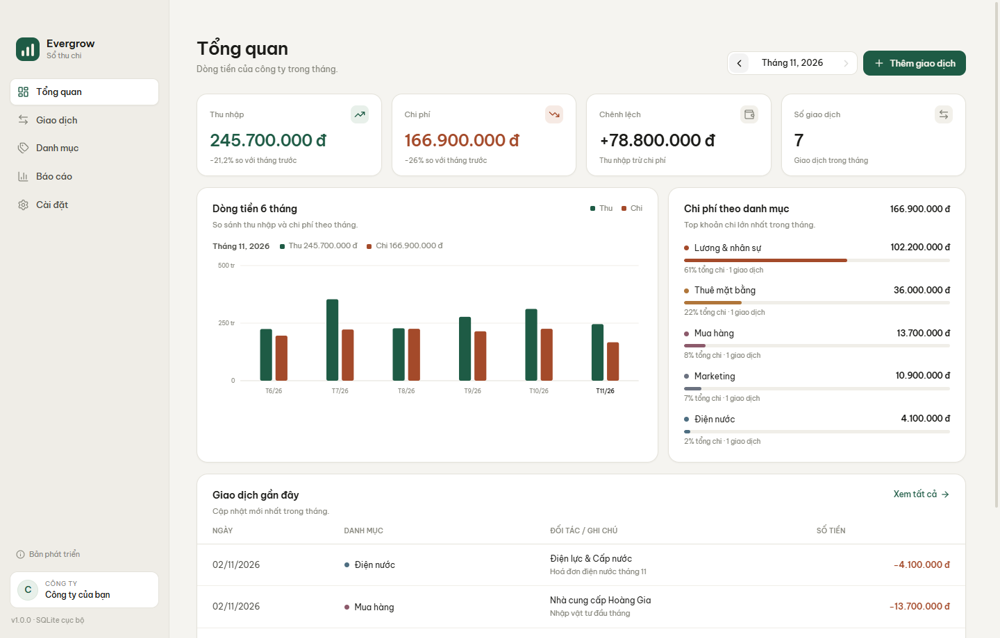
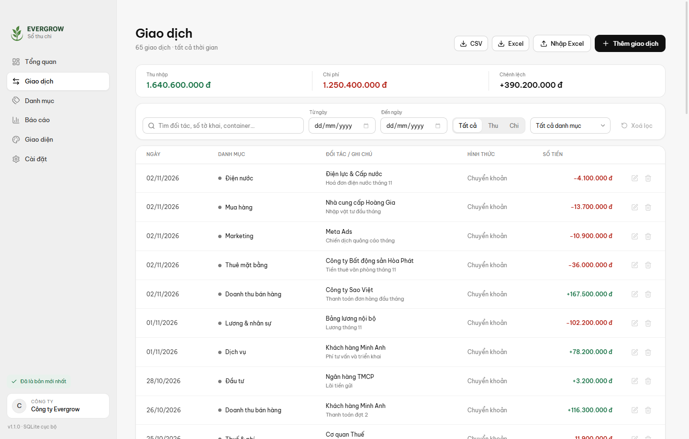
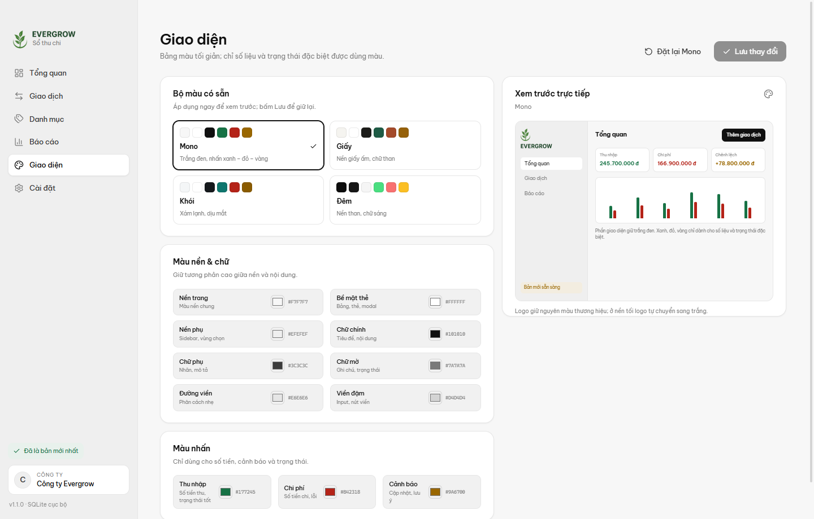
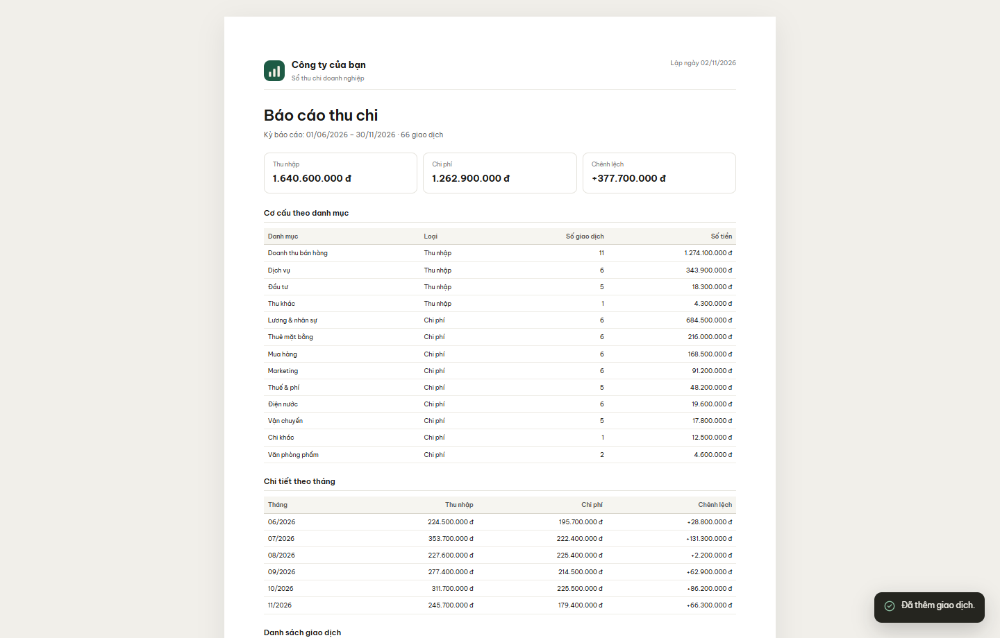

# Evergrow Books

Sổ thu chi doanh nghiệp gọn nhẹ cho Windows. Dữ liệu nằm trong một tệp SQLite trên máy, không cần tài khoản, không cần máy chủ.



## Điểm chính

- **Giao diện Mono**: nền trắng đen, chữ và viền trung tính; chỉ số liệu thu/chi, cảnh báo và trạng thái đặc biệt dùng xanh lá, đỏ, vàng.
- **Theme editor**: 4 bộ màu có sẵn (Mono, Giấy, Khói, Đêm) và chỉnh từng màu nền/chữ/màu nhấn; lưu vào SQLite và áp dụng cho cả thanh tiêu đề Windows.
- **Tổng quan** theo tháng: thu nhập, chi phí, chênh lệch, biểu đồ 6 tháng, cơ cấu chi phí.
- **Lô hàng**: gộp thu/chi theo Số tờ khai, xem doanh thu, chi phí, lợi nhuận và biên lợi nhuận từng lô.
- **Công nợ**: theo dõi hạn thanh toán, đã trả, còn nợ; phân loại phải thu/phải trả, quá hạn và tuổi nợ.
- **Ngân sách**: đặt hạn mức chi phí theo danh mục/tháng, theo dõi tiến độ và danh mục vượt ngân sách.
- **Chứng từ**: lưu ảnh/PDF hóa đơn trực tiếp trong SQLite, mở hoặc xoá theo từng giao dịch.
- **Đa tiền tệ**: nhập USD/EUR/CNY với tỷ giá, quy đổi VND để báo cáo nhưng vẫn giữ tiền tệ gốc.
- **Sao lưu tự động** mỗi ngày và **hoàn tác lần nhập Excel** từ lịch sử.
- **Giao dịch vận đơn**: ngày, số tờ khai, cửa khẩu, đối tác, tên hàng, loại hàng, số container, kích thước 20'/40', đơn vị vận chuyển, hình thức thanh toán, chi tiết phí.
- **Nhập Excel** từ file mẫu hai sheet, xem trước, tự tạo danh mục, bỏ qua giao dịch trùng.
- **Xuất CSV / XLSX / PDF** chuẩn hóa, có tổng hợp và logo công ty.
- **Sao lưu / phục hồi** trực tiếp từ tệp `.db`.
- **Tự động cập nhật** qua GitHub Releases: kiểm tra khi mở app và mỗi 4 giờ, tải ngầm, cài khi khởi động lại.
- **Bộ cài wizard** (NSIS), đóng gói sẵn Electron và SQLite — máy người dùng không cần cài Node.js hay môi trường nào khác.



## Nhập Excel

Mở **Giao dịch → Nhập Excel**, chọn tệp `.xlsx`. App đọc được mẫu **KH Thanh toán / Tiền làm hàng**; tệp Excel do app xuất cũng nhập lại được dữ liệu cốt lõi.

| Nguồn | Trường được nhập |
| --- | --- |
| Sheet 1 · KH Thanh toán | Ngày GH, SỐ TK, Cửa, Tên Cty, Tên Hàng, Loại hàng, Thành Tiền, các cột phí |
| Sheet 2 · Tiền làm hàng | SỐ TK, Đơn vị vận chuyển, Số Cont, cột 20'/40', Tổng Chi, các cột phí |

Cách xử lý khi nhập:

- Ô merge được mở rộng để lấy ngày/tờ khai/cửa khẩu của nhóm dòng.
- Thiếu ngày: chọn **lấy ngày dòng trước** hoặc **bỏ qua**; có cảnh báo trước khi nhập.
- Tự tạo danh mục dạng `Doanh thu <Loại hàng>` / `Chi phí <Loại hàng>`.
- Dòng có cùng dấu vân tay (ngày, số tiền, số TK, container, đối tác, hàng hóa) bị bỏ qua khi nhập lại.
- Tổng tiền được tính lại từ từng dòng; không dùng ô “TỔNG CỘNG” có sẵn trong file mẫu.
- “Còn Lại” không lưu thành cột riêng; app tính chênh lệch thu – chi theo kỳ và bạn có thể lọc theo Số TK để đối chiếu từng lô.

## Lô hàng, công nợ, ngân sách, chứng từ

- **Lô hàng** nhóm các giao dịch theo Số tờ khai, tính tổng thu, tổng chi, lợi nhuận và biên lợi nhuận. Bấm một dòng để xem các giao dịch thu/chi của lô.
- **Công nợ**: trong giao dịch, bật **Theo dõi công nợ**, nhập hạn thanh toán và số đã trả. Trang Công nợ có phải thu/phải trả, quá hạn, tuổi nợ và nút ghi thanh toán từng phần.
- **Ngân sách**: chọn tháng, đặt hạn mức cho từng danh mục chi phí; app hiển thị đã chi, còn lại, % sử dụng và tô cảnh báo khi gần/vượt hạn mức. Có thể sao chép ngân sách tháng trước.
- **Chứng từ**: mở lại một giao dịch đã lưu để đính kèm ảnh/PDF (tối đa 10 MB). Tệp được lưu trong SQLite nên tự đi kèm khi sao lưu/phục hồi.
- **Đa tiền tệ**: chọn VND, USD, EUR hoặc CNY; nhập số tiền gốc và tỷ giá, app quy đổi VND cho báo cáo nhưng vẫn lưu và xuất tiền tệ gốc.
- **Sao lưu tự động**: mỗi ngày khi mở app, tạo bản sao lưu trong `%APPDATA%\Evergrow Books\backups`, giữ 14 bản tự động gần nhất và 10 bản trước thao tác import/undo/reset.
- **Hoàn tác nhập Excel**: vào **Cài đặt → Lịch sử nhập Excel**, bấm Hoàn tác để xoá toàn bộ giao dịch của một lần nhập. Một bản sao lưu được tạo trước khi hoàn tác.

Trang Giao dịch mặc định **Không lọc**, hiển thị toàn bộ giao dịch cho đến khi bạn chọn ngày/loại/danh mục. Sidebar chia thành hai nhóm **Sổ sách** và **Hệ thống**.

## Giao diện

Trang **Giao diện** cho phép chọn bộ màu và chỉnh từng màu:

- Nền trang, bề mặt thẻ, nền phụ, chữ chính, chữ phụ, chữ mờ, viền, viền đậm.
- Màu nhấn: thu nhập (xanh), chi phí (đỏ), cảnh báo (vàng).
- Xem trước trực tiếp trước khi lưu; rời trang mà không lưu sẽ quay về bộ màu đang dùng.
- Logo giữ màu thương hiệu trên nền sáng và tự chuyển trắng trên nền tối.



## Xuất tệp

| Định dạng | Nội dung |
| --- | --- |
| CSV | Bảng phẳng 23 cột, UTF-8 BOM, ngày `dd/mm/yyyy`, số tiền nguyên, có chi tiết phí, tiền tệ gốc, tỷ giá, công nợ và số chứng từ. Chặn công thức Excel từ dữ liệu nhập. |
| XLSX | Sheet **Tổng hợp** có logo, thẻ tổng thu/chi/chênh lệch, cơ cấu danh mục, tổng hợp tháng; sheet **Thu** và **Chi** có bộ lọc, cố định tiêu đề, tổng dòng, cột ngoại tệ/công nợ/chứng từ và định dạng in A4 ngang. |
| PDF | Báo cáo A4: logo, tổng hợp, cơ cấu danh mục, chi tiết tháng, danh sách giao dịch kèm số tờ khai, container, ngoại tệ và công nợ còn lại. |



## Cài đặt

1. Mở trang [Releases](https://github.com/Megumi1608/evergrow-books/releases).
2. Tải `Evergrow-Books-Setup-x.y.z.exe`.
3. Chạy bộ cài, chọn thư mục và hoàn tất wizard.

Yêu cầu: Windows 10/11 x64. Bản cài chưa ký số nên Windows SmartScreen có thể hiện cảnh báo — chọn **More info → Run anyway**.

## Dữ liệu

- Cơ sở dữ liệu: `%APPDATA%\Evergrow Books\evergrow-books.db` (SQLite, WAL), bao gồm cả chứng từ đính kèm.
- Bản sao lưu tự động: `%APPDATA%\Evergrow Books\backups`.
- Nút **Mở thư mục** trong Cài đặt đưa thẳng tới tệp đang dùng.
- **Sao lưu** tạo một tệp `.db` độc lập; **Phục hồi** thay thế dữ liệu hiện tại. Chứng từ nằm trong tệp nên đi kèm bản sao lưu.
- Nâng cấp phiên bản tự động bổ sung cột/bảng mới, giữ nguyên dữ liệu cũ.
- Dữ liệu không được mã hoá. Hãy bảo vệ tệp `.db` và các bản sao lưu.
- App không gửi dữ liệu lên máy chủ. Khi kiểm tra cập nhật, chỉ phiên bản ứng dụng được đối chiếu với GitHub.

## Tự động cập nhật

- App đọc bản phát hành mới nhất từ repo public, tải ngầm qua `electron-updater` và kiểm tra SHA-512 trong `latest.yml`.
- Trạng thái hiển thị ở thanh bên và trong **Cài đặt → Cập nhật ứng dụng**.
- Khi tải xong, bấm **Khởi động lại & cập nhật**; bản cài cũng được áp dụng khi thoát app.

### Phát hành bản mới

```bash
npm version patch            # tăng phiên bản
npm run build
npx electron-builder --win nsis
gh release create v1.1.1 \
  release/Evergrow-Books-Setup-1.1.1.exe \
  release/latest.yml \
  release/Evergrow-Books-Setup-1.1.1.exe.blockmap \
  --title "Evergrow Books 1.1.1" --notes "Nội dung cập nhật"
```

Luôn tải kèm `latest.yml` và tệp `.blockmap`; thiếu một trong hai thì tự cập nhật sẽ không hoạt động.

## Phát triển

Yêu cầu: Node.js 22+ và npm. Chỉ cần Windows khi đóng gói installer.

```bash
npm install
npm run dev        # Vite + Electron, dữ liệu dev riêng
npm run typecheck
npm run verify     # build, mở Electron thật, chụp ảnh và kiểm tra xuất tệp
npm run dist       # tạo installer NSIS
```

`npm run verify` dùng Playwright để mở app, nạp dữ liệu mẫu, xuất CSV/XLSX/PDF và sao lưu `.db`, sau đó kiểm tra nội dung tệp. Ảnh và tệp kiểm thử nằm trong `.verify/` (không commit).

### Cấu trúc

```
src/main/       Electron main, SQLite, IPC, importer, exporter, updater
src/preload/    Cầu contextBridge có kiểu
src/renderer/   React + TypeScript + Vite, trang Giao diện và theme
src/shared/     Kiểu dữ liệu, theme, brand assets, tiện ích dùng chung
scripts/        build, dev, verify, tạo logo/icon
assets/         Logo gốc và các biến thể đã tách nền
build/          icon.ico / installer assets
```

### Bảo mật

- `contextIsolation`, `sandbox`, không bật `nodeIntegration`.
- IPC chỉ mở các kênh cần thiết; mọi dữ liệu được kiểm tra lại ở main process.
- Truy vấn SQLite dùng tham số; danh mục/giao dịch có khoá ngoại và CHECK constraint.
- CSV chặn formula injection; XLSX ghi chuỗi an toàn.
- Cửa sổ mới và điều hướng ngoài bị chặn; liên kết GitHub mở qua shell hệ điều hành.

## Giới hạn hiện tại

- Windows x64, một người dùng trên một máy.
- Số tiền là số nguyên đồng (VND), không hỗ trợ tiền tệ khác.
- Không nhập được giao dịch ở tương lai.
- Chi tiết phí được lưu và hiển thị, nhưng chưa tách thành bút toán riêng trong báo cáo.
- Bản phát hành chưa ký số nên có thể bị SmartScreen cảnh báo.
